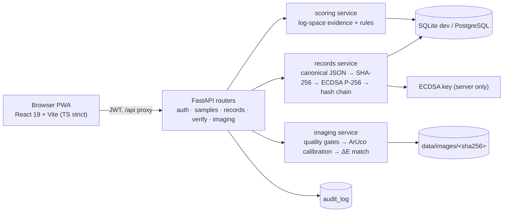

# FieldProof

**Verified field test records.** A mobile-first Progressive Web App that gives police
officers *explainable* decision support when using existing colorimetric field-test
kits, and turns every test into a tamper-evident, digitally signed record.

> **PRESUMPTIVE RESULT ONLY.** FieldProof never replaces laboratory confirmatory
> testing (GC-MS, LC-MS, FTIR…). Colour tests cannot measure concentration:
> *“Concentration: not determinable from presumptive tests.”*

---

## Status: build step 9 of 9 — demo data, demo mode, polish, final review

| Step | Scope | Status |
|------|-------|--------|
| 1 | Backend skeleton, auth, DB models, seed data | done |
| 2 | Scoring engine + unit tests | done |
| 3 | Canonical JSON, hash, ECDSA signature, chain, verify endpoint | done |
| 4 | Image quality gates, card detection, colour correction, ΔE matching | done |
| 5 | Design system, component library, `/design` page | done |
| 6 | Frontend: sign-up/login, dashboard, sample/test entry, analysis result | done |
| 7 | Camera capture, image analysis integration, signed record screen | done |
| 8 | Log + search + export, verification page | done |
| 9 | Demo seed, demo mode, design polish, README, final review | **done** |

## Image representation


## Repository layout

```
fieldproof/
├── backend/                 FastAPI + SQLAlchemy (SQLite dev / PostgreSQL-ready)
│   ├── app/
│   │   ├── main.py          app factory, CORS, lifespan (auto-seed)
│   │   ├── config.py        pydantic-settings (env prefix FIELDPROOF_)
│   │   ├── database.py      engine, session, Base, utcnow()
│   │   ├── models.py        all tables (append-only records enforced)
│   │   ├── enums.py         roles, statuses, disclaimer text, demo citation
│   │   ├── color.py         sRGB→CIELAB + CIEDE2000
│   │   ├── security.py      argon2 hashing, JWT issue/verify
│   │   ├── deps.py          current user + role gates
│   │   ├── rate_limit.py    sliding-window login limiter
│   │   ├── audit.py         audit-log helper
│   │   ├── schemas.py       pydantic request/response models
│   │   ├── seed.py          reference data (kits/outcomes/reactions cite published sources)
│   │   ├── seed_demo.py     8 signed demo records through the real pipeline
│   │   ├── services/
│   │   │   ├── scoring.py     identification engine (log-space evidence scoring)
│   │   │   ├── canonical.py   canonical JSON + SHA-256
│   │   │   ├── signing.py     ECDSA P-256 (key never leaves the server)
│   │   │   ├── records.py     record payload, hash-chain, export bundle
│   │   │   ├── verify.py      verification checks (image/hash/signature/chain)
│   │   │   ├── images.py      unmodified image storage, named by hash
│   │   │   └── imaging/       step 4: quality gates, ArUco card, ΔE matching
│   │   │       ├── quality.py   blur / exposure / glare / resolution gates
│   │   │       ├── card.py      detection, warp, patch sampling, correction fit
│   │   │       ├── reading.py   ROI colour + CIEDE2000 outcome matching
│   │   │       ├── pipeline.py  analyze_image() orchestration
│   │   │       └── synth.py     synthetic scenes for tests + demo images
│   │   ├── config/reference_card.json  printable card geometry + patch values
│   │   └── routers/           auth, meta, analysis, samples, records, verify, imaging, admin
│   ├── scripts/smoke_step3.py end-to-end demo against a running server
│   ├── scripts/smoke_imaging.py      image-analysis demo
│   ├── scripts/generate_reference_card.py   printable PDF → docs/reference-card.pdf
│   ├── scripts/generate_test_images.py      demo scenes → docs/images/
│   ├── tests/                 pytest suite
│   ├── requirements.txt
│   ├── pytest.ini
│   └── .env.example
├── frontend/                React 19 + Vite + TypeScript
│   ├── src/
│   │   ├── styles/          tokens.css (design tokens), base.css, components.css
│   │   ├── components/      Button, Badge, StatusPill, Card, Form, Alert,
│   │   │                    Disclaimer, DataTable, Dialog, Logo, DemoMode, …
│   │   ├── design/          /design page: foundations, components, hard rules
│   │   ├── lib/             constants (mirrors backend enums), status meta, theme
│   │   └── main.tsx         theme bootstrap + styles
│   ├── scripts/             browser E2E (e2e-flow, e2e-log-verify, e2e-step7,
│   │                        e2e-demomode, e2e-signup, e2e-back — Playwright via system Edge)
│   └── vite.config.ts       dev proxy /api → 127.0.0.1:8000, `@` alias
├── docs/                    reference-card.pdf, images/ (demo scenes),
│                            screenshots/ (E2E output)
└── README.md
```

## Prerequisites

* Python **3.11+** (built and tested on 3.12) and Node **20+** (built and tested on 24)
* No PostgreSQL required for development — SQLite is used out of the box and the
  schema avoids SQLite-only types, so it runs unchanged on PostgreSQL.

## Setup

```powershell
cd fieldproof
py -3.12 -m venv .venv
.\.venv\Scripts\python.exe -m pip install -r backend\requirements.txt
copy backend\.env.example backend\.env      # then edit secrets

cd frontend
npm install
```

## Run

```powershell
cd fieldproof\backend
..\.venv\Scripts\python.exe -m app.seed          # optional; also auto-runs on startup
..\.venv\Scripts\python.exe -m uvicorn app.main:app --reload --port 8000
```

(from `fieldproof\backend` the interpreter is `..\.venv\Scripts\python.exe`)

* API + Swagger: <http://127.0.0.1:8000/docs>
* Health: <http://127.0.0.1:8000/api/health>
* Meta (disclaimer, engine version, option lists): <http://127.0.0.1:8000/api/meta>

Frontend (separate terminal; dev server proxies `/api` to the backend):

```powershell
cd fieldproof\frontend
npm run dev            # http://localhost:5173  → /design design system
npm run build          # type-check + production build
npm run lint           # oxlint
```

Useful seed commands (run from `fieldproof\backend`):

```powershell
python -m app.seed            # idempotent reference-data insert (also auto-runs on startup)
python -m app.seed --reset    # drop + rebuild + seed reference data
python -m app.seed_demo       # create/refresh the 8 demo records (see below)
python -m app.seed_demo --reset  # wipe demo records, rebuild reference data, reseed demo
```

`python -m app.seed_demo` creates **8 demo samples/records with real data only** —
each one goes through the actual services (canonical JSON → SHA-256 → ECDSA →
hash chain), including camera captures analysed through the real image pipeline.
Nothing is hand-edited in the database and no signature is faked. Records are
tagged with a `[seed_demo] <slug>` marker in the sample notes, so re-running is
idempotent (already-created slugs are skipped). The script also self-verifies
every record it created (`verify_record` must PASS, expected status/flags must
match) and prints a summary.

## Test

```powershell
cd fieldproof\backend
..\.venv\Scripts\python.exe -m pytest
```

Frontend verification:

```powershell
cd fieldproof\frontend
npm run lint
npm run build
```

Expected: **97 passed** — auth/RBAC/rate-limit, seed citation (exact match) + size guard, colour
conversion, CIEDE2000 (Sharma reference pairs), the scoring-engine suite
(single/agreeing/contradicting tests, mixture flag, lab override, floor
likelihood, hard rules, "no hardcoded substance names" guard), the record
suite: canonical JSON determinism, SHA-256 vectors, ECDSA sign/verify + tamper
detection, chain linking, append-only enforcement, role gates, override auditing,
list filters/pagination, CSV/JSON export, audit trail, and verify PASS/FAIL for
clean, tampered-payload, broken-chain, wrong-image and one-byte-changed-image
cases — plus the imaging
suite: card detection/patch sampling, calibration improvement under warm light,
every quality-gate failure mode, ΔE matching (exact/far/ambiguous/no-refs), ROI
validation, the analyze endpoint (auth, happy path, kit-type/reject cases,
audit) and the reference-card endpoint.

Live end-to-end demo (server must be running):

```powershell
..\.venv\Scripts\python.exe scripts\smoke_e2e.py        # login → sample → test → sign → verify
..\.venv\Scripts\python.exe scripts\smoke_step3.py http://127.0.0.1:8000
..\.venv\Scripts\python.exe scripts\smoke_imaging.py      # port 8017
```
Prints a signed record, then `verify clean: PASS` and `verify tampered: FAIL`.

Browser E2E (backend :8000 + frontend :5173 running; uses system Edge, writes
screenshots to `docs/screenshots/`; exit 0 = all checks pass):

```powershell
cd fieldproof\frontend
$env:SHOT_DIR="..\docs\screenshots"
node scripts\e2e-flow.mjs          # login → wizard → result screen   (34 checks)
node scripts\e2e-log-verify.mjs    # finalize → log → CSV → verify     (44 checks)
node scripts\e2e-step7.mjs         # camera capture → gates → sign     (55 checks)
node scripts\e2e-demomode.mjs      # demo ribbon, tour, toggle, 360px   (34 checks)
node scripts\e2e-signup.mjs        # sign up → auto-login → re-login   (21 checks)
node scripts\e2e-back.mjs          # wizard back-nav regression        (25 checks)
```

## Demo accounts (seeded, placeholder data)

| Username | Password | Role |
|----------|----------|------|
| `officer1` | `FieldProof#Demo1` | OFFICER |
| `officer2` | `FieldProof#Demo2` | OFFICER |
| `lab1` | `FieldProof#Lab1` | LAB |
| `admin` | `FieldProof#Admin1` | ADMIN |

No account? Use **Create one** on the login page (`/signup`): self-service
registration creates an OFFICER account and signs you straight in. LAB and
ADMIN roles are provisioned by an administrator (API/DB only in this build).

## Seed data notice

Every seeded **kit, outcome and expected-reaction row carries a verbatim
citation** to the published forensic method it derives from (UNODC,
NIJ Standard-0604.01, O'Neal et al. 2000, manufacturer colour charts, BTNX
product insert, peer-reviewed studies). Where sources conflicted, both
readings are seeded with their sources; where no source was found, no rows
are seeded and such readings score as non-discriminating. Substance
descriptions (names, aliases, appearance notes) are generic field metadata
and are labelled:

> `DEMO DATA - verify against UNODC Recommended Methods and the kit
> manufacturer's colour chart before real use`

The full 36-cell matrix, the likelihood scheme, the seeded citations and the
verbatim research report live in
[`docs/reaction-data.md`](docs/reaction-data.md).

Seed size (enforced by a test): 6 kits, 6 substances, 22 outcomes,
33 expected reactions (24 of the 36 substance × kit pairs; 12 pairs have no
published data).

## Three-minute demo script

```powershell
# 1. Reset and seed (from fieldproof\backend)
python -m app.seed --reset       # reference data
python -m app.seed_demo          # 8 demo records through the real pipeline

# 2. Run (two terminals)
python -m uvicorn app.main:app --port 8000      # backend  :8000
cd ..\frontend && npm run dev                    # frontend :5173
```

1. **Sign in** at <http://localhost:5173> as `officer1` / `FieldProof#Demo1`.
   The blue **DEMO MODE** ribbon is visible on every screen — click
   *Take the tour* for the 5-step walkthrough (New test → Result → Signed
   record → Log → Verify), dismissible with Esc/Skip at any point.
2. **Dashboard** — 8 seeded samples, all shown as *Signed record*.
3. **New test** — create a sample, choose the MARQUIS kit, record
   *Purple turning black*, review → sign. The result screen shows the
   confidence gauge, ranked alternatives, per-test evidence, "Why this
   result", the disclaimer and the exact concentration line; the signed
   panel shows the SHA-256 record hash and ECDSA signature with copy +
   *Download record JSON*.
4. **Camera** (optional, in the wizard's Result step) — upload
   `docs\images\scene_ideal.png` as fallback: quality gates → calibration
   screen (patches, ΔE) → Accept/Override → sign.
5. **Log** — open a row: summary, tests, analysis + disclaimer, hash &
   signature, verification checklist; try *Export CSV*.
6. **Verify** — *Try a valid example* → all checks **PASS**; *Try a
   tampered example* → record hash/registry **FAIL** with reasons.
7. Toggle the moon icon for dark mode; the ribbon's switch turns demo
   labelling off (persisted in `localStorage`).

## Architecture summary



* **Frontend** (`frontend/`): mobile-first React PWA, design tokens + `fp-`
  component library, 5-step New Test wizard with local draft autosave, result
  screen, append-only log with per-record verification badges, verification
  page, demo-mode ribbon/tour. Client never computes hashes or signatures — it
  displays exactly what the server returns.
* **Backend** (`backend/`): FastAPI + SQLAlchemy; JWT auth (argon2) with RBAC
  and a login rate limiter; every mutation lands in `audit_log`. Finalisation
  runs the record pipeline (canonical JSON → SHA-256 → ECDSA P-256 → hash
  chain) and stores it append-only (`records` rejects UPDATE/DELETE). Image
  analysis is deterministic and explainable; any failed quality gate forces
  `INCONCLUSIVE`.
* **Data**: one SQLite file for dev (`backend/data/fieldproof.db`), images as
  immutable files named by their SHA-256, swap to PostgreSQL via
  `FIELDPROOF_DATABASE_URL` (no SQLite-only types).

## API reference

| Method | Path | Role |
|--------|------|------|
| POST | `/api/auth/login` | public (rate-limited, 5 fails / 5 min) |
| POST | `/api/auth/register` | public (rate-limited per IP; always creates OFFICER, returns token) |
| GET | `/api/auth/me` | any authenticated |
| POST | `/api/auth/logout` | any authenticated |
| POST | `/api/analysis/preview` | any authenticated (LAB role required for `LAB_CONFIRMATORY` observations) |
| POST | `/api/samples` | OFFICER / LAB / ADMIN |
| GET | `/api/samples`, `/api/samples/{id}` | OFFICER / LAB / ADMIN |
| POST | `/api/samples/{id}/tests` | OFFICER / LAB / ADMIN (`LAB_CONFIRMATORY` = LAB / ADMIN only) |
| GET | `/api/samples/{id}/analysis` | OFFICER / LAB / ADMIN |
| POST | `/api/samples/{id}/finalize` | OFFICER / LAB / ADMIN (creates the signed record) |
| GET | `/api/records` | any authenticated — filters: `q`, `status_filter`, `operator`, `kit`, `substance`, `date_from`, `date_to`, `lat`, `lon`, `radius_km`, `page`, `page_size`, `sort_by`, `sort_dir` |
| GET | `/api/records/export` | any authenticated (CSV of the filtered list) |
| GET | `/api/records/{id}` | any authenticated (detail + verification badge + audit trail) |
| GET | `/api/records/{id}/export?format=json\|csv` | any authenticated (verification bundle) |
| POST | `/api/verify` | any authenticated — multipart: `record` (JSON file), optional `image` |
| POST | `/api/images`, GET `/api/images/{sha256}` | any authenticated (store/fetch original bytes by hash) |
| POST | `/api/images/analyze` | OFFICER / LAB / ADMIN — multipart: `file`, `kit_code`, optional `roi`, `time_since_reaction_seconds` |
| GET | `/api/reference-card` | any authenticated (printable card layout + known patch values) |
| GET | `/api/health` | public |
| GET | `/api/meta` | public |
| GET | `/api/admin/users` | ADMIN |
| GET | `/api/admin/audit-log` | ADMIN |
| GET | `/api/admin/signing-keys` | ADMIN |

## Database tables (all created in step 1)

`users`, `samples`, `substances`, `tests` (kit definitions), `test_outcomes`,
`expected_reactions`, `sample_tests`, `records` (append-only + hash-chained),
`audit_log`, `signing_keys`.

Notes:

* `records` rejects UPDATE and DELETE at the ORM level — corrections must be new,
  linked records.
* Times are stored as naive UTC.

## Identification engine (step 2)

`backend/app/services/scoring.py` — explainable, data-driven, **no hardcoded
substance logic** (enforced by a unit test that greps the module for drug/kit names).

* Equal priors over active substances → for each observation multiply by the
  expected likelihood from `expected_reactions` **in log space**, with a floor of
  `0.02` so unexpected-but-possible outcomes never eliminate a candidate →
  normalise to percentages.
* Evidence classification per test for the leading candidate: likelihood ≥ 0.50
  **supports**, ≤ 0.10 **contradicts**, otherwise weak/not decisive.
* Rules layer → status ladder `NO_MATCH → WEAK_PRESUMPTIVE → PRESUMPTIVE →
  STRONG_PRESUMPTIVE → CONFIRMED_BY_LAB`:
  * top score < 30 % → `NO_MATCH`
  * only one informative presumptive test → capped at `WEAK_PRESUMPTIVE`
  * contradiction or top-two gap < 15 pts → flag
    `Possible mixture or ambiguous: refer to laboratory` (and caps the status)
  * all tests inconclusive/unusable → `INCONCLUSIVE`
  * `CONFIRMED_BY_LAB` **only** from a `LAB_CONFIRMATORY` entry with a method and
    a compound that resolves against the `substances` table (LAB/ADMIN role is
    enforced at the API layer).
* Every result carries: ranked list + alternatives that cannot be ruled out,
  per-test supports/contradicts evidence, known cross-reacting substances for the
  outcomes used, `Concentration: not determinable from presumptive tests` (or the
  lab-entered purity), the disclaimer, and a plain-language explanation.

Try it live:

```powershell
# login, then POST /api/analysis/preview with observations (see /docs)
curl -X POST http://127.0.0.1:8000/api/auth/login -H "Content-Type: application/json" `
     -d '{"username":"officer1","password":"FieldProof#Demo1"}'
# then:
# {"observations":[
#   {"ref":"t1","test_type":"COLOUR_REAGENT","kit_code":"MARQUIS","outcome_code":"PURPLE_BLACK","outcome_label":"Purple turning black"},
#   {"ref":"t2","test_type":"COLOUR_REAGENT","kit_code":"MECKE","outcome_code":"PURPLE","outcome_label":"Purple"}]}
```
→ `STRONG_PRESUMPTIVE`, MDMA 93.3 % (demo data), alternatives + explanation shown.

## Tamper-evident records (step 3)

**Canonical JSON → SHA-256 → ECDSA P-256 → hash chain → append-only storage.**

1. `finalize` serialises the record payload as canonical JSON
   (sorted keys, compact separators, UTF-8, `allow_nan=False`) — the exact bytes
   are stored in `records.canonical_json`.
2. `record_hash = SHA-256(canonical_json bytes)`.
3. The hash is signed with **ECDSA P-256** (Prehashed SHA-256) on the server;
   signature + `public_key_id` are stored. The private key comes from
   `FIELDPROOF_SIGNING_PRIVATE_KEY` (or `FIELDPROOF_SIGNING_KEY_FILE`); in
   development a key is auto-generated at `backend/data/dev_signing_key.pem`.
   **Only the public key is ever exposed.**
4. Each record stores `previous_record_hash` = the hash of the previous record →
   editing or deleting any record breaks every link after it. `records` rejects
   UPDATE/DELETE at the ORM level; corrections are new, linked records.
5. Original images are stored **unmodified** at `data/images/<sha256>.<ext>`.

**Verification (`POST /api/verify`)** accepts the exported bundle (+ optional
image) and returns PASS/FAIL per check:

| Check | What it proves |
|-------|----------------|
| Image hash | uploaded bytes hash to the recorded `image_sha256` |
| Record hash | canonical JSON matches the fields **and** hashes to `record_hash` |
| Signature | ECDSA signature valid for that hash under the registered public key |
| Chain | `previous_record_hash` resolves to the true predecessor in the registry |
| Registry | uploaded copy is byte-identical to the server's stored copy |

Tampering examples that are detected: edited status/percentage, edited
canonical JSON, swapped image, broken `previous_record_hash`, doctored export.

```powershell
..\.venv\Scripts\python.exe scripts\smoke_step3.py http://127.0.0.1:8000
```

## Image pipeline (step 4)

`backend/app/services/imaging/` — **quality gates → reference-card calibration →
ROI colour → CIEDE2000 matching**, fully explainable, any failed gate forces
`INCONCLUSIVE` (no colour match is ever reported from a bad photo).

1. **Quality gates** (per-ROI, each pass/fail is returned with the value and the
   threshold): resolution ≥ 640×480, blur (variance of Laplacian ≥ 100),
   exposure (mean 30–230, ≤ 25 % blown-out pixels), glare (specular fraction),
   reference card present with 4 ArUco markers, calibration RMS ≤ 12 ΔE.
2. **Reference card** (`config/reference_card.json`, printable PDF:
   `docs/reference-card.pdf`): 100×70 mm, ArUco `DICT_4X4_50` ids 0–3 at the
   corners, 7 known colour patches. Detected → perspective-warped to a canonical
   1000×700 image → patches sampled → 3×3 least-squares correction fitted in
   sRGB so the measured patches match their published values (warm/cool
   lighting is removed before the sample colour is read).
3. **ROI colour**: median sRGB of the (corrected) region → CIELAB → ranked
   ΔE00 distances to the kit's published outcome colours.
4. **Matching rules**: best ΔE > 15 → inconclusive; margin to the second-best
   < 3 ΔE → inconclusive (`too close to call`); otherwise `MATCH` with the
   ranked list, ΔE, margin and the kit's interpretation/cross-reactions.
5. Every response carries the disclaimer and
   `Concentration: not determinable from presumptive tests`.
   The camera result is *decision support only* — it never writes a result by
   itself; the officer still selects/confirms the outcome.

Synthetic scenes for tests and the README are generated by
`scripts/generate_test_images.py` (ideal, warm light, blur, glare, missing
marker, dark) into `docs/images/`. Manual demo:

```powershell
..\.venv\Scripts\python.exe -m uvicorn app.main:app --port 8017
..\.venv\Scripts\python.exe scripts\smoke_imaging.py
```

## Design system (step 5)

`frontend/src/styles/tokens.css` holds every colour, type step, spacing value,
radius and shadow as CSS custom properties with a **light and dark theme**
(`data-theme` on `<html>`, persisted, no flash on load).

* Components live in `frontend/src/components/` with `fp-`-prefixed classes and
  one barrel export: Button (4 variants × 3 sizes + loading), Badge (7 tones),
  StatusPill (the whole result ladder with tooltips), Card, Field/Text/Select/
  Textarea/Checkbox, Alert, **Disclaimer** (renders the exact disclaimer +
  concentration strings from `src/lib/constants.ts`, which mirrors
  `backend/app/enums.py`), DataTable, SegmentedControl, Stat, KeyValue,
  EmptyState, Skeleton/Spinner/LoadingBlock, Dialog (Esc/backdrop close), Logo,
  PageHeader.
* The **`/design` page** (`/design` route) documents foundations (live colour
  swatches reading the resolved token values, type scale, spacing, radii,
  elevation), demos every component in both themes, and lists the product hard
  rules (disclaimer everywhere, never "confirmed" without `CONFIRMED_BY_LAB`,
  exact concentration string, demo-data labelling, AA contrast, ≥40 px targets).
* `npm run dev` → <http://localhost:5173/design>; `npm run build` type-checks
  (strict TS) and bundles; `npm run lint` runs oxlint.

## Security notes

* Passwords hashed with **argon2id**.
* Sessions are **JWT (HS256)** with `sub`, `role`, `iat`, `exp`, `iss` claims;
  secret comes from `FIELDPROOF_JWT_SECRET` (never committed — `.env.example` only).
* Record signing uses a separate **ECDSA P-256** key held only on the server
  (env var / file); the private half is never sent to clients and never stored in
  the database — only `public_key_pem` + `key_id` are.
* Role checks on every protected endpoint (`OFFICER`, `LAB`, `ADMIN`).
* Login rate limiting (sliding window, in-process — swap for Redis with multiple workers).
* All logins, sample/test edits, overrides, record views, exports and
  verification runs are written to `audit_log`.

## Limitations

* **Presumptive only.** Colour/immunoassay tests are decision support; every
  result screen, record and export carries the disclaimer and the exact line
  `Concentration: not determinable from presumptive tests`. Confirmatory
  methods (GC-MS, LC-MS, FTIR…) are required before any substance is
  considered identified.
* **GPS and device time are spoofable.** Mitigations implemented: GPS accuracy
  is recorded with the fix (plus a mock-location warning flag), and
  `server_timestamp` is taken from the server for the record and the hash
  chain rather than trusting the device clock.
* **Chain of custody and legal admissibility are out of scope.** The hash
  chain and signatures prove a record has not changed since signing on this
  server; they do not by themselves establish evidentiary continuity.
* **Reaction data is researched, not authoritative.** Every seeded row
  carries a verifiable citation (full matrix + verbatim research report:
  [`docs/reaction-data.md`](docs/reaction-data.md)), but colour reactions
  vary with substrate, age and concentration — independently verify every
  value before any real use.
* **The uncertainty band is a heuristic, not a statistic.** The result gauge
  shows the engine's posterior share for the leading candidate; the band
  beneath it is a documented shrinkage heuristic (labelled in the UI and in
  `analysis.confidence.method`), not a statistical confidence interval.
* **PDF / QR export is not implemented** (`GET /api/records/{id}/export?format=pdf`
  returns 422, so no PDF button is rendered); CSV export and signed
  record-JSON download are available.
* **No lab-confirmatory or admin UI** — `LAB_CONFIRMATORY` entries and admin
  functions are reachable via the API with the appropriate role only.
* **Offline queue is not implemented** — the PWA shell loads offline, but
  writes require the backend to be reachable.
